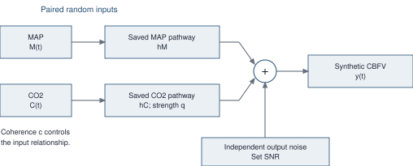
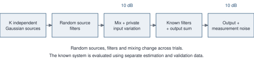
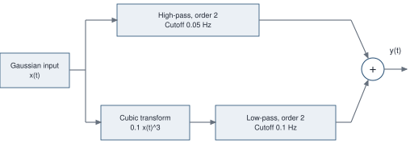
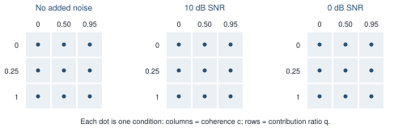
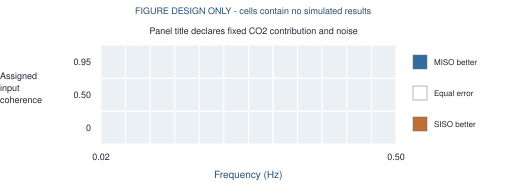
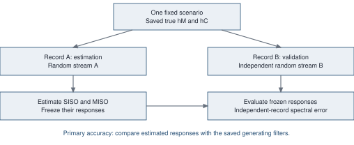
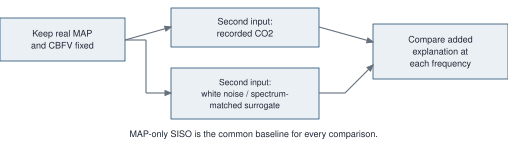

# A reproducible MISO-SISO simulation study

Proposed protocol v2 | 13 September 2026 | Revised for Shotaro feedback and frequency-first figures

## The recommendation

Keep the existing known-truth simulator. Use it to answer one question: **When does including CO2 improve recovery of the MAP-to-CBFV pathway, and when does the added estimation uncertainty outweigh that benefit?** Report CO2-pathway recovery separately.

Combine Westwick's repeated random-input experiments with Chertoff's checks against known response curves. Neither paper trained a generative model to produce its simulation inputs. Our first study does not need one either.

<!-- DIAGRAM:overview -->


**Three controls, one primary accuracy measure evaluated across frequency.** Vary input coherence, relative CO2 contribution, and output noise. The principal figures have frequency on the horizontal axis, a specified factor or diagnostic on the vertical axis, and MISO-versus-SISO accuracy advantage as color. Band-averaged scores are synopses. Keep duration, input shapes, pathway shapes and estimator settings fixed in the main experiment. Use separate checks for phase and alternative shapes.

This is a controlled methods benchmark with physiologically motivated features. It is not a claim that the simulated parameter combinations occur with these frequencies in humans. NC data are optional for contextualizing the conditions, not required to define simulation truth.

Shotaro's proposed sequence is retained: **Step 1, the current known-truth simulation; Step 2, a later extension using more realistic inputs.** Preserve prior simulations and their provenance as legacy evidence; decide which results enter the manuscript after the metric audit. The learned generator is optional, not a prerequisite. Main noise levels remain no noise, 10 dB and 0 dB; these are benchmark choices, not clinical ranges.

<!-- PAGE -->

## 1. What Westwick actually simulated

Source [1]: supplied PDF pages 8-10, Figure 1 on page 16, Figures 3-5 on pages 18-20.

They investigated identifying a system from many correlated, band-limited inputs and choosing a useful subset of inputs. The simulation was constructed mathematically:

<!-- DIAGRAM:westwick -->


| Step | Specification in the paper |
|---|---|
| Independent sources | K independent Gaussian white-noise sequences |
| Shape source bandwidth | Separate Butterworth filters: orders 1-4; cutoffs 10-90% of Nyquist |
| Create correlated inputs | Random K-by-N mixing matrix, with N greater than K |
| Avoid perfect dependence | Add N independent Gaussian sequences at 10 dB signal/noise power ratio |
| Define the true system | Separate Butterworth filters: orders 1-5; cutoffs 10-80% of Nyquist; random output mixing weights |
| Add observation noise | Independent white output noise at 10 dB SNR |
| Repeat | Normally 100 trials; redraw noises, filters and mixing matrices while keeping K and N fixed within a set |

The added input-specific variation is **upstream of the generating filters**. It helps the inputs carry distinguishable information. It is not equivalent to corrupting measured inputs after the physical output has already been generated.

Their Figure 4 uses K=10, N=20 and 2,000 samples split into 1,000 estimation and 1,000 validation samples. Estimated FIR filters have 32 taps. Retaining more singular-value components improves fitted-data performance, but eventually worsens validation performance. The plotted bands are standard deviations across 100 simulated datasets.

Their principal score is squared correlation between observed and predicted outputs, not our transfer-function error. Squared correlation can miss amplitude scaling errors. Also, their fSISO/fMISO labels describe input-selection rules; this is not a direct replication of our two-input spectral comparison.

**Borrow:** controlled dependence, limited bandwidth, known filters, independent-data evaluation and Monte Carlo repetition. **Do not borrow:** neural frequency ranges or many-input selection machinery. The supplied methods give randomization bounds but not a complete seed/mixing-distribution specification for exact replay.

<!-- PAGE -->

## 2. What Chertoff actually simulated

Source [2]: supplied PDF section 4.2 on page 4; Figure 2 on page 12; Figure 4 on page 14; Table 1 on page 19.

They built a deliberately simple system to demonstrate distortion of a linear estimate when an additional correlated branch is ignored:

<!-- DIAGRAM:chertoff -->


One Gaussian white-noise input drives both branches. The linear branch is a second-order Butterworth high-pass filter with 0.05 Hz cutoff. The other branch cubes the input, multiplies it by 0.1, and applies a second-order Butterworth low-pass filter with 0.1 Hz cutoff. Their outputs are added. No added output-noise term is described in this simulation.

The ordinary linear estimate contains contributions from the cubic branch. The proposed decomposition recovers the assigned linear and nonlinear branch responses more closely; the comparison includes gain, phase and cutoff. Total coherence approaches one in this known-system example. This is a mechanism demonstration, not a Monte Carlo map of short-record performance.

**The second branch is not measured CO2.** We should not generate CO2 as MAP cubed or interpret the paper's 0.1 Hz nonlinear filter as a validated CO2 response. What transfers is the idea of saving the two generating contributions and testing whether an estimator separates them.

### Limits that matter for our study

Table 1 lists 10 Hz sampling, 4,098 samples per subrecord, 122 subrecords, 500,000 total samples, 5,000 seconds, and 0.0024 Hz resolution. The total samples and sampling rate imply **50,000 seconds**, not 5,000. The page image confirms these printed values. We should not silently select a correction and claim an exact replication. Either duration is substantially longer than our 300-second recordings.

Their real-data analysis is also distinct: section 4.4 constructs a nonlinear regressor using measured CBFV and the derivative of pressure, after exploring candidate nonlinearities. Thus the reported real-data coherence is descriptive model fit; it is not independent forward prediction of unobserved CBFV from MAP/CO2. The paper does not report a separate held-out test for that choice. We will not use measured output to manufacture a predictor in our validation pipeline.

**Borrow:** known branch responses and explicit checks of gain/phase recovery. **Add for our question:** short-record noise, repeated random realizations, null controls, and estimation/validation separation.

<!-- PAGE -->

## 3. Our generating system: fixed and inspectable

The main generator remains a stationary linear two-input system:

```text
CBFV fluctuation = filtered MAP + filtered CO2 + independent output noise
y[n] = (hM * M)[n] + (hC * C)[n] + e[n]
```

The asterisk means causal filtering. Store hM, hC and both output contributions. Compute truth from the saved coefficients, never from a fitted synthetic recording.

| Fixed setting | Proposed primary value and basis |
|---|---|
| Sampling / retained duration | 4 Hz / 300 seconds: 1,200 samples; consistent with a common TFA recording scale [4] |
| Underlying generation length | 600 seconds, 120 seconds warmup, and 6 seconds guard at each end; fixed 732-second generation; use prefixes for duration comparisons |
| Input spectral shape | Retain the current Gaussian-shaped spectrum: center 0.06 Hz, width parameter 0.045 Hz, floor 0.01; initially use the same shape for both inputs |
| Input scales | MAP SD 1 mmHg, CO2 SD 0.5 mmHg in the ensemble; declared reference scales, not population norms |
| MAP pathway | Retain existing high-pass-like FIR construction: gain setting 1.5, low-frequency fraction 0.25, time constant 3 seconds |
| CO2 pathway | Retain delayed exponential FIR construction: time constant 5 seconds, delay 3 seconds; gain determined by assigned contribution ratio |
| FIR support | Existing six-time-constant truncation and discrete normalization; save final coefficients including delay zeros |
| Frequency band | Fixed calibration and primary scoring band 0.02-0.50 Hz; plot the same band |
| Welch settings | 100-second Hann window, 50% overlap, 400-point FFT, triangular spectral smoothing [0.25, 0.50, 0.25] applied identically to both methods [4] |

This yields five overlapping Welch windows and 0.01 Hz bin spacing. The windows are not five independent subjects. Zero-padding would not add resolving information. The existing 128-second setting belongs in one predeclared compatibility check; no estimator-setting sweep is primary.

The MAP/CO2 response forms have physiological motivation: pressure responses attenuate slow changes, while CO2 responses have slower dynamics [2,3]. **The exact spectra, scales and time constants above are benchmark choices. Neither supplied paper establishes them as normal physiological ranges.** Reference [3] supports a dynamic CO2 response, not this exact kernel. These defaults retain the project's simple generator while eliminating random nuisance-parameter changes.

Use centered fluctuations. No baseline is needed for the estimation benchmark; any added display baseline is metadata. Do not imply that the reference gain setting calibrates absolute clinical CBFV.

<!-- PAGE -->

## 4. The main experiment has 27 conditions

<!-- DIAGRAM:grid -->


| Assigned factor | Levels | Reason |
|---|---|---|
| MAP-CO2 magnitude-squared coherence, c | 0, 0.50, 0.95 | Independent, moderately related, difficult to separate |
| CO2/MAP contribution RMS ratio, q | 0, 0.25, 1 | No CO2 effect, smaller effect, equal component RMS |
| Output SNR | Infinity, 10 dB, 0 dB | No added noise, noise power one-tenth of signal, equal noise and signal power |

Every combination is included. These are experimental levels, not clinical cutoffs. In the q=0 condition CO2 still varies; only its output pathway is zero. This tests the cost of including an unnecessary input. Do not remove the CO2 column.

### How the controls are implemented

Generate independent unit-variance Gaussian sources u and v. Before spectral shaping, use u for MAP and `sqrt(c)*u + sqrt(1-c)*v` for CO2. With fixed deterministic shaping, this sets population magnitude-squared coherence to c. Use separate input scaling based on the designed spectral variance; do not repeatedly normalize each short record to make realized statistics look exact. Finite-record estimates will vary, including apparent nonzero coherence when c=0.

Calibrate q from the designed input spectra and filters over the fixed band: q is the RMS of the CO2-driven component divided by the RMS of the MAP-driven component. Scale the CO2 filter before random realizations. At q=0 its coefficients are exactly zero. Report achieved component ratios without discarding deviations.

q is not a share of total output variance: correlated contributions include a covariance term. Noise is independent Gaussian output disturbance. Set its variance using expected clean-output power over the full 0-2 Hz Nyquist range, then report achieved SNR. This preserves independence rather than adapting noise amplitude to every short record. The main experiment intentionally holds SNR, not absolute noise, across different q/c conditions.

### Repetitions

Run 100 repetitions per condition as a development pilot. After correctness checks and freezing the protocol, use **500 fresh repetitions per condition**: 13,500 condition-repetition pairs, each with an estimation and a validation recording. Both estimators analyze the same pair. Reuse underlying random draws across conditions to support paired comparisons, while keeping estimation and validation streams independent.

At 500 repetitions the largest standard error of a win proportion is about 2.24 percentage points. Quantify uncertainty of the frequency-resolved advantage using paired repetitions as well; a near-tie remains inconclusive if its uncertainty is too large. Do not increase repetitions only until a desired significance level is reached.

<!-- PAGE -->

## 5. Primary results: frequency-by-factor heatmaps

<!-- DIAGRAM:heatmap -->


A factor is something we assign, such as input coherence. A diagnostic is something we measure, such as a coherence gap. An accuracy metric compares an estimate with saved truth. Name all three explicitly so the word "metric" does not conceal different roles.

| Main map | Vertical axis | Conditions held fixed or shown in facets |
|---|---|---|
| Input dependence | Assigned MAP-CO2 coherence c: 0, 0.50, 0.95 | Separate q and SNR facets |
| CO2 contribution | Assigned component RMS ratio q: 0, 0.25, 1 | Separate c and SNR facets |
| Noise sensitivity | Assigned output SNR: 0 dB, 10 dB, no noise | Separate c and q facets |

Every panel uses frequency horizontally and the same signed advantage scale. Put MAP-pathway recovery first, CO2 recovery separately. No-noise SNR is a categorical row, not an arbitrarily distant numerical value. Three assigned levels mean three genuine rows: do not interpolate them into an apparently dense physiological continuum. Start with the 27-condition design; any later denser sweep must add declared simulation levels before production, not cosmetic smoothing.

Show a manageable selection of explicitly conditioned panels in the main text, and the full facet set in the supplement. Select their conditions before looking at advantage. Suggested reference slices are coherence at q=0.25/SNR=10 dB, contribution at c=0.50/SNR=10 dB, and noise at c=0.50/q=0.25. Include the q=0 null slice and difficult c=0.95 slice visibly. Do not silently pool different conditions into one row.

Absolute SISO and MISO error maps accompany the advantage maps, with matched absolute-error scales. A neutral advantage can mean both estimators perform well or both perform poorly. Optional gain-error and phase-error maps unpack the combined error. A 3D surface is a secondary rendering of the same stored cells; band summaries are secondary reductions of those same results.

<!-- PAGE -->

## 6. Define advantage before running the experiment

For pathway P and repetition r, define a frequency-resolved complex squared error:

```text
e_method,r(f) = abs(H_estimated_method,r(f) - H_true(f))^2 / D
D = mean over the fixed band of abs(H_true(f))^2
A(f) = log10( mean_r e_SISO,r(f) / mean_r e_MISO,r(f) )
```

The denominator D is computed from truth alone and is identical for both estimators; it does not depend on estimate failures. For the zero CO2 pathway, save absolute squared error instead. **A is a log ratio of mean errors, not a mean of per-repetition log ratios.** The current plotting code uses the latter, so introduce a new score version and explicit label; do not mix old and new exports.

Color interpretation: A=0 means equal mean squared error; A=+1 means SISO has ten times MISO's mean squared error; A=-1 means MISO has ten times SISO's. Positive blue favors MISO, negative orange favors SISO, white is a tie. Keep raw values. Display limits must flag saturation rather than alter the data. If both mean errors are exactly zero, mark an exact tie; if only one is zero, store the infinite ratio and flag it. Do not silently add a scientific error floor to make ratios finite.

Use the same successful paired repetitions at each frequency, with separate method-specific failure counts and eligible denominators. A finite-case advantage is conditional on successful estimates; do not claim overall superiority if failures differ. Low-power bins remain visible with diagnostics. A shared truth-based phase mask applies only to phase error, never to the primary complex error. Undefined phase, empty cells and insufficient counts are gray, not zero advantage.

Quantify Monte Carlo uncertainty by resampling whole paired repetition IDs, retaining the full frequency vector and shared IDs across conditions. Use 1,000 bootstrap resamples with separately saved analysis randomness. Report pointwise 95% intervals and counts; distinguish them from simultaneous confidence across the entire map. Frequency bins and overlapping Welch windows are not independent repetitions. Any broad region-level inferential claim needs a prespecified simultaneous procedure; the primary maps are effect estimates, not a field of unadjusted significance tests.

### Independent validation and fairness

<!-- DIAGRAM:validation -->


Estimate on A and evaluate frozen responses using B's spectral matrix. Retain the prediction residual at each frequency as a secondary map; call this independent-record spectral prediction, not waveform forecasting. Compare joint MISO with each SISO separately; do not sum two separately fitted SISO predictions. Use shared preprocessing and unregularized solvers in the main comparison. tfest and ridge remain optional later comparators.

The target is the generating pathway. A two-input linear generator matches MISO's structure to isolate omitted-input bias versus finite-record variability. Null, independent-input and noisy near-collinear controls support a conditional methods claim, not universal superiority.

<!-- PAGE -->

## 7. Shotaro's coherence hypothesis: test, do not assume

Shotaro suggests relating multiple minus partial coherence to estimation accuracy. Include this as a **frequency-by-diagnostic heatmap**, with accuracy advantage as color. Specify the partial quantity as MAP-CBFV given CO2. All coherence quantities below are magnitude-squared quantities in [0,1], not their square roots.

| Diagnostic | Definition at frequency f | Interpretation |
|---|---|---|
| Shotaro gap G | Multiple coherence minus partial MAP-CBFV given CO2 | His proposed association with pathway accuracy |
| Added explanation Delta | Multiple coherence minus ordinary MAP-CBFV coherence | Improvement in fitted explanation over MAP alone |
| Conditional CO2 coherence | Partial CO2-CBFV given MAP | Association between residual CO2 and residual CBFV after removing MAP |

The two gaps answer different questions. With a common spectral matrix, an invertible input block, defined partial coherences and unregularized estimation, the spectral regression identities give [5,6]:

```text
Delta = (1 - ordinary MAP-CBFV coherence)
        * partial CO2-CBFV given MAP
G = ordinary CO2-CBFV coherence
    * (1 - partial MAP-CBFV given CO2)
```

These are algebraic consequences of the definitions, not empirical discoveries. A small G does not generally imply small MISO accuracy advantage. For a simple counterexample, take noiseless y=M+C, unit input powers, and real cross-spectrum 0.5 (input squared coherence 0.25). Both true pathways equal 1. Population multiple coherence and partial MAP-CBFV given CO2 both equal 1, so G=0; nevertheless MAP-only SISO equals 1.5 and joint MISO equals the true value 1. Finite-record estimates need not attain these exact population values.

Thus Shotaro's suggestion is a useful **hypothesis map**, not a predetermined threshold rule. Include G as requested and Delta as the directly interpretable added-fit diagnostic. Conditional CO2 coherence can be exported without becoming another mandatory main figure. High fitted coherence or high Delta is not itself proof of true pathway recovery.

For diagnostic maps, bin the diagnostic separately at every frequency. Do not assign a band-average gap to every frequency. Initially use fixed edges 0:0.1:1, with the final bin including 1; report out-of-range numerical values rather than clipping silently. Require at least 30 distinct repetition IDs per displayed bin and show counts. Pool only the declared equal-weight 27-condition reference ensemble, facet by SNR, and retain scenario composition. Bootstrap repetition IDs across all scenarios together.

A diagnostic and error estimated from the same recording have statistical coupling; label their relationship descriptive. Before presenting a usable prediction rule, test whether diagnostics from A also predict recovery when estimators are independently refit on B, and evaluate any fitted rule on held-out scenarios. Do not transfer a simulation-derived gap threshold to human data without separate validation.

<!-- PAGE -->

## 8. Real recordings: Shotaro's irrelevant-input control

The simulation asks whether estimates recover a known pathway. The real-data arm asks whether adding CO2 explains additional CBFV variability beyond MAP and an irrelevant-input reference. These are complementary outcomes. Real-data color must be called **added explanation** or **held-out prediction advantage**, never accuracy against unknown true pathways.

<!-- DIAGRAM:realcontrol -->


Keep real MAP and CBFV fixed. First run MAP-only SISO, then MISO with real CO2. Repeat MISO using independent white noise as the second input, as Shotaro suggests. Add a spectrum-matched CO2 surrogate control so a slow physiological input is not compared only with spectrally dissimilar noise. Use independent Fourier phases with conjugate symmetry and the recorded CO2 Fourier magnitudes; preserve DC/Nyquist rules and save every surrogate seed. This preserves the full-record spectrum, not every short-window spectrum or the empirical amplitude distribution.

Use 500 draws per null type per recording as a proposed starting count. At each frequency save Delta for real CO2 and its null distribution; display observed-versus-null excess and uncertainty. Validate null behavior on known independent simulated inputs first. Any surrogate p-value uses (1 + number of null values at least as large as observed)/(B + 1), and frequency/subject multiplicity must be handled before declaring significance. Resample participants, not isolated samples, for cohort uncertainty; keep each participant's records and frequency vectors together.

Both controls test an unrelated-second-input reference. Independent phase randomization also breaks MAP-CO2 association, so this is not a formal conditional test of CO2 beyond MAP under preserved input dependence. A conditional residual-surrogate method would be a separate extension. Retain ordinary, partial and multiple coherence, but distinguish descriptive fitted improvement from independent predictive benefit.

The repository already implements CO2 circular shifts and band summaries. Keep that as a timing sensitivity check; a shift is not guaranteed to destroy frequency-domain association, especially for persistent narrowband oscillations. A pure population delay rotates cross-spectral phase while preserving coherence magnitude. Do not relabel shifted CO2 as independent noise. New controls need frequency-resolved exports.

Use separate recordings or prespecified contiguous validation blocks with leakage guards when data permit; do not randomly shuffle individual time points into cross-validation folds. Short recordings may not support adequate independent spectral validation. Subject bootstrap quantifies sampling uncertainty, not accuracy relative to an unknown human transfer function. NC is needed for this real-data arm, not for the primary simulation.

<!-- PAGE -->

## 9. Phase and robustness without another factorial

Choose four anchors before seeing results: q in {0,1}, c in {0,0.95}, all at 10 dB output SNR. Repeat the same random realizations under the following separate interventions. These checks test portability of the main findings; they are not a new optimization exercise.

| Check | Prespecified change | Held fixed |
|---|---|---|
| Duration | 300 versus 600 seconds | Same master recording, filters and noise scale |
| Input timing | CO2 input shifted -3, 0, +3 seconds before output generation | Input auto-spectra, coherence magnitude and pathways |
| Pathway timing | CO2 filter delay 0, 3, 6 seconds | Input pair and all other filter parameters |
| Input shape | A separate slower CO2 spectral template: center 0.03 Hz, width 0.02 Hz, same floor | MAP template and pathway shapes; q recalibrated from the declared spectra |
| Pathway shape | One engineering contrast: second-order Butterworth MAP high-pass at 0.05 Hz and CO2 low-pass at 0.1 Hz, plus 3-second CO2 delay | Input pair; q recalibrated; saved digital filter coefficients |
| Disturbance color | Independent AR(1) disturbance with 2-second correlation time | Reference disturbance variance; white-noise case remains primary |

The alternate filters borrow Chertoff's **test shapes**, not an interpretation of its nonlinear branch as CO2 physiology. The slower input spectrum and colored-disturbance time scale are declared sensitivity choices. They do not establish physiological intervals. If broader clinical applicability is later claimed, replace or supplement them with protocol-matched empirical/literature support.

For phase/delay checks, freeze absolute noise variance at the unshifted-input, 3-second-pathway-delay reference. Constructive/destructive addition can otherwise change noise amplitude and confound the timing question. Allow adequate history for both positive and negative input shifts; never wrap the retained recording endpoints. q=0 pathway-delay duplicates are bookkeeping checks, not independent conditions.

MAP-CBFV and CO2-CBFV pairwise phases emerge from the two inputs and two pathways. They cannot all be assigned independently. At fixed auto-spectra and input coherence magnitude, pure input-phase rotation does not alter normalized spectral-matrix conditioning. A phase effect should therefore be interpreted through its actual mechanism, not assumed to imply better input separation.

**Phase figures:** save MAP-CO2, MAP-CBFV and CO2-CBFV phase at each frequency. The assigned intervention is a delay; phase is its frequency-dependent consequence. Use frequency-by-delay maps for controlled tests and frequency-by-phase-bin maps for descriptive associations. Keep input phase, true pathway phase and pairwise input-output phase in separate named fields. Input-output phases emerge from the full system and cannot all be varied independently. Initially use fixed 30-degree circular bins, a common branch convention, and counts; undefined phase is excluded with its reason. Preserve discontinuities at the wrap boundary rather than interpolating across them. Do not assume phase must produce an advantage effect.

**NC's optional role:** plot observed input spectra, amplitude ratios and coherence against our settings, after resolving timing quality. An optional later hybrid check can use real MAP/CO2 as inputs to known synthetic pathways. Real CBFV is never the accuracy reference for unknown true pathways. Training, clustering or resampling NC data is not needed to define the primary generator.

<!-- PAGE -->

## 10. Reproducibility and implementation contracts

Separate a **scenario** (fixed scientific settings), a **repetition** (random draw), and a **record role** (estimation or validation). Their IDs must not depend on loop order or how many scenarios are requested.

1. Save one resolved configuration, the complete scenario table, source-code version including uncommitted changes, and MATLAB/toolbox versions.
2. Use the proposed seed/substream map in `REPRODUCIBILITY_SPEC.json` for inputs, disturbance and validation. Save the resolved mapping, not only a seed integer.
3. Fix the master duration, warmup, FFT grid and amplitude/noise calibration before running. Adding a plot, reordering conditions or resuming must not change old recordings.
4. Save input/output components, filters, seeds, achieved diagnostics, numerical results and failures per completed case. Keep figure generation separate from simulation.
5. Replay selected cases and the same scenarios in reversed order; compare signals and scores. Declare numerical tolerances for cross-version replay rather than promising universal bitwise identity.

### Preserve the useful core

| Keep | Change |
|---|---|
| Known filters and causal output construction | Fixed main templates instead of randomized time constants |
| Shared spectral estimation and current SISO/MISO solvers | A 3-by-3-by-3 explicit scenario table, independent of five-level design machinery |
| Truth errors and independent-realization spectral validation | True zero-pathway support, common failure accounting and contribution-based gain calibration |
| Checkpoints and output regeneration | Stable IDs, separate streams, fixed generation horizon and calibration/reporting separation |
| Existing configuration structure | One short study entry point; advanced settings hidden from the default user workflow |

Run focused correctness checks before scientific production: saved gain/delay recovery; independent-input and zero-pathway controls; requested versus ensemble-achieved spectra/coherence; cross-spectrum sign; matched built-in comparison; independent validation streams; and replay/order invariance. Correct code may still show finite-record error in a noiseless case because of spectral windowing and smoothing.

Two metric discrepancies need focused checks before reuse: `calculateFrequencyTruthErrors` currently normalizes over frequencies where an estimate is finite, while `getSimulationFrequencyError` has a fallback using pointwise true power. Unify truth-only normalization and zero/low-gain rules, version exports, and reject incompatible cached errors. Also verify coherence identities on the unregularized spectral matrix; ridge-selected coefficients must not be used to report ordinary multiple coherence without an explicit different definition.

A simple methods statement is: "We compared joint and separate transfer-function recovery using known causal pathways, controlled input dependence and independent output disturbance. A full factorial varied coherence, CO2 contribution and noise. Frequency-resolved error-ratio maps, paired Monte Carlo repetitions and separate validation recordings quantified performance under declared benchmark assumptions."

<!-- PAGE -->

## 11. Implement in reviewable chunks

| Chunk | Deliverable | Acceptance evidence |
|---|---|---|
| 1. Definitions and correctness | Frequency-level result schema; truth errors; coherence identities; preserved legacy outputs | Analytic one/two-input and zero-pathway examples, phase-sign and built-in comparisons; zero-gap counterexample reproduced |
| 2. Reproducible generator | Explicit 27-condition table, fixed templates, stable random streams, independent A/B records | Replay, loop-order and resume invariance; requested versus ensemble-achieved spectra, q and SNR |
| 3. Primary figure pipeline | Frequency-by-factor maps, matched absolute-error maps, paired uncertainty and CSV exports | Every plotted cell traced to saved repetitions; new ratio-of-means score verified; no re-simulation when changing a plot |
| 4. Explanatory checks | Shotaro and added-explanation diagnostic maps; phase and other small robustness checks | Correct per-frequency bins, common masks, distinct repetition counts and disclosed scenario composition |
| 5. Real-data entry point | User file path, column mapping, timing/units validation, same SISO/MISO analysis, noise/surrogate controls | End-to-end fixture; one recorded-data demonstration when available; no claims of known human truth |

Review chunk 1 before changing generation. After chunks 2-3, review the 100-repetition pilot, freeze scientific settings, then run the fresh 500-repetition production experiment. If the pilot motivates new factor levels or diagnostics, version the protocol before production; do not selectively add them after seeing final advantage.

### Proposed module boundaries

```text
configuration + scenario table
             |
  simulation generator  OR  recorded-data adapter
             |                      |
             +---- shared signal validation ----+
                              |
                  shared spectra and SISO/MISO
                              |
       truth accuracy (simulation) / explanation (real data)
                              |
                 saved per-frequency results
                              |
                  statistics -> figures/export
```

Use one simulation entry point and one data-analysis entry point. The user chooses a preset or file path and, when needed, maps columns and confirms sampling/units. Folder and function names are finalized during implementation; avoid introducing a second parallel analysis engine. Result fields must retain scenario, repetition, record role, frequency, pathway, truth, each estimate, each error, coherence diagnostics, phase definitions and failure reasons. Figure rendering must consume these saved results independently of generation.

The learned `model_generator` remains a documented Step 2 option. A simpler first realism extension is to drive saved known filters with real MAP/CO2 inputs. Generating learned transfer functions is a further assumption requiring its own validation, not something either supplied paper establishes.

<!-- PAGE -->

## Sources and scope

[1] Westwick DT et al. *Identification of Multiple-Input Systems with Highly Coupled Inputs: Application to EMG Prediction from Multiple Intracortical Electrodes.* Neural Computation. 2006;18:329-355. DOI: 10.1162/089976606775093855. Supplied `nihms78743.pdf`, especially pp. 8-10, 16, 18-20.

[2] Chertoff ME et al. *A Novel Nonlinear System Identification for Cerebral Autoregulation in Human: Computer Simulation and Validation.* Annals of Biomedical Engineering. 2020;48:1207-1217. DOI: 10.1007/s10439-019-02442-7. Supplied `nihms-1743684.pdf`, especially pp. 4-8, 12, 14, 19.

[3] Panerai RB et al. IEEE TBME. 2000;47:419-423. [Multivariate cerebral-flow analysis](https://pubmed.ncbi.nlm.nih.gov/10743786/).

[4] Panerai RB et al. JCBFM. 2023;43:3-25. [CARNet TFA update](https://pmc.ncbi.nlm.nih.gov/articles/PMC9875346/).

[5] MathWorks. [Magnitude-squared and multiple coherence definitions](https://www.mathworks.com/help/signal/ref/mscohere.html). The identities and counterexample in section 7 are our algebraic deductions for a common unregularized spectral matrix.

[6] Krafty RT et al. [Conditional spectral analysis of replicated multiple time series](https://pmc.ncbi.nlm.nih.gov/articles/PMC5805231/). Spectral coherence and partial/multiple relationships as frequency-domain regression quantities.

Shotaro source: user-supplied email excerpt, reviewed 13 September 2026. His proposals motivate sections 7-8; neither the new threshold interpretation nor a completed validation study is attributed to him.

Repository evidence: existing generator, shared spectral solvers, truth/prediction metrics and saved proof250 audit. This protocol is not implemented or newly validated. Relevant source PDF pages were visually checked. No simulation results are claimed.
