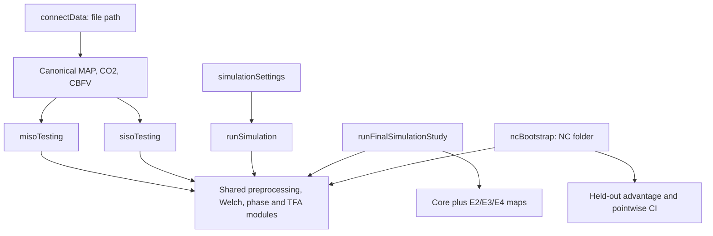

# Independent workflow

The standalone project has three user workflows and one final study
orchestrator. They share numerical modules but keep their settings and accuracy
targets separate.

| Entry point | Purpose | Main return |
| --- | --- | --- |
| `connectData` | Read and standardize one CSV or Excel recording | Canonical time, MAP, CO2, CBFV and source metadata |
| `misoTesting` | Analyze one recording jointly | MAP and CO2 transfer functions, multiple/partial coherence, frequency table, figure and optional export |
| `sisoTesting` | Analyze the same recording separately | Two SISO transfer functions, ordinary coherence, frequency table, figure and optional export |
| `simulationSettings` | Expose editable simulation settings | Settings with factor provenance |
| `runSimulation` | Run an exploratory known-truth configuration | Frequency-by-factor advantage maps |
| `runFinalSimulationStudy` | Run the frozen core and secondary experiments | Seventeen named source-table maps and precision audit |
| `ncBootstrap` | Evaluate NC held-out prediction | Subject-averaged frequency advantage, SD, pointwise CI and valid subject count |
| `createFinalMisoTfaReport` | Render saved scientific outputs | One nine-page PDF and its NC source CSV files |

A single observed recording has no known truth and no held-out comparison, so
the MISO and SISO pages return model results separately. The NC workflow owns
the empirical MISO-versus-SISO accuracy comparison.

The final heatmaps place frequency on the horizontal axis, the selected
recording or mechanism factor on the vertical axis, and MISO advantage in
color. Band averages are synopsis values only. MAP-CBFV and CO2-CBFV phase are
recorded outcomes; E2 varies the CO2 timing relative to MAP because that is the
input relationship that changes estimator separation.

## Where to edit

| Change you want to make | Start here |
| --- | --- |
| File path or one-recording settings | `interfaces/connectData.m`, `misoTesting.m`, `sisoTesting.m` |
| Simulation settings | `interfaces/simulationSettings.m` and `config/simulationFactors.m` |
| Synthetic signal generation and known pathways | `modules/simulation/knownTruth/generateKnownTruthRealization.m` |
| Frozen experiment sequence | `modules/simulation/runFinalSimulationStudy.m` |
| NC folds, held-out predictions, bootstrap | `modules/ncValidation/` |
| Shared SISO/MISO estimation | `modules/tfa/runSISOTFA.m`, `runMISOTFA.m` |
| Shared preprocessing and analysis sequence | `modules/tfa/analyzeTfaSignals.m` and `modules/preprocessing/` |
| Single-recording figures and exports | `modules/realData/` |
| Simulation heatmaps and exports | `modules/simulation/` |
| Paper wording | `manuscript/main.tex` |
| Paper figures from frozen results | `modules/reporting/generateManuscriptAssets.m` |
| Rebuild the paper | `buildManuscript.m` |

The entry points remain small functions with explicit inputs and outputs.
Numerical routines that serve several workflows remain shared. Short
bookkeeping functions used by one routine live at the bottom of that routine's
file, so reading the workflow requires fewer file jumps.
