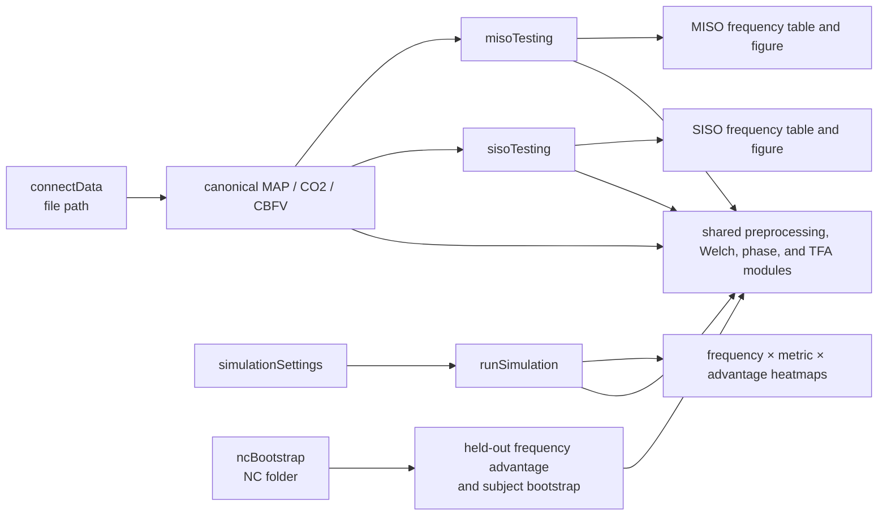

# Independent workflow

The `miso_tfa` folder is the migration target for the project. It has one
setup function, six user-facing pages, and shared numerical modules.

## User-facing pages

- `connectData(filePath)` loads one Excel or CSV recording. It performs header
  matching and returns canonical signals without choosing a model.
- `misoTesting(connectedData)` runs the two-input MAP/CO2 transfer-function
  model and returns frequency-resolved results and a figure.
- `sisoTesting(connectedData)` runs the MAP-only and CO2-only models using the
  same connected recording.
- `simulationSettings(profile)` returns the editable known-truth simulation
  design. `runSimulation(settings)` runs it and can export an archive.
- `ncBootstrap(dataFolder)` runs blocked NC validation and returns the
  frequency-wise held-out advantage plus subject-level bootstrap summaries.

The interfaces own workflow choices. The folders under `modules/` contain
reusable functions and do not read file paths or create paper figures unless a
reporting function is explicitly called.

## Simulation interpretation

The primary simulation score is the conditional pathway error of MISO versus
SISO. A positive advantage means the SISO error divided by the MISO error is
greater than one on a log10 scale. Input coherence and pathway strength are
primary family conditions; recording duration and broadband output SNR are
observation conditions. Input phase, input SNR, and alignment are secondary
robustness experiments.

The 4 Hz sampling rate gives a 2 Hz Nyquist frequency. Results are reported in
the 0.02–0.35 Hz physiological band. The pathway calibration band is stored
separately so changing a display range cannot silently change the generated
truth.

The generator varies MAP–CO2 input phase when that factor is enabled. The
MAP–CBFV and CO2–CBFV phases are consequences of the two input signals and the
two known pathways; they are recorded as outputs and are not independently
assigned parameters.
