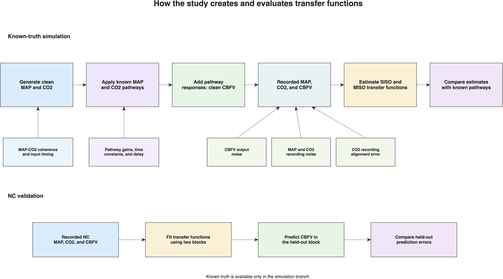
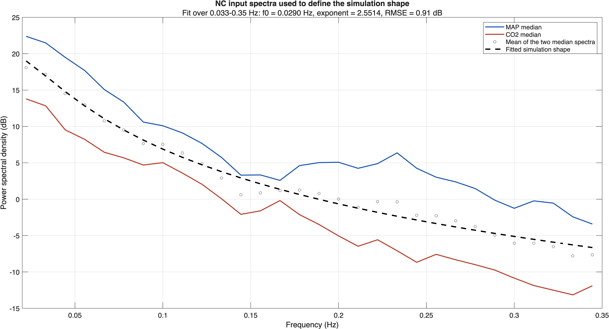
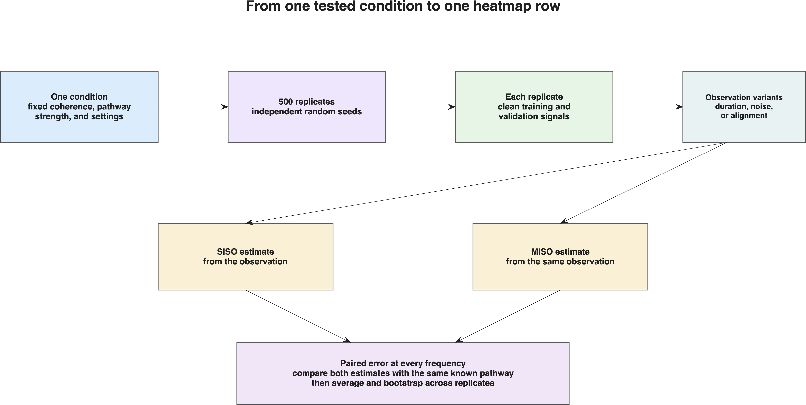
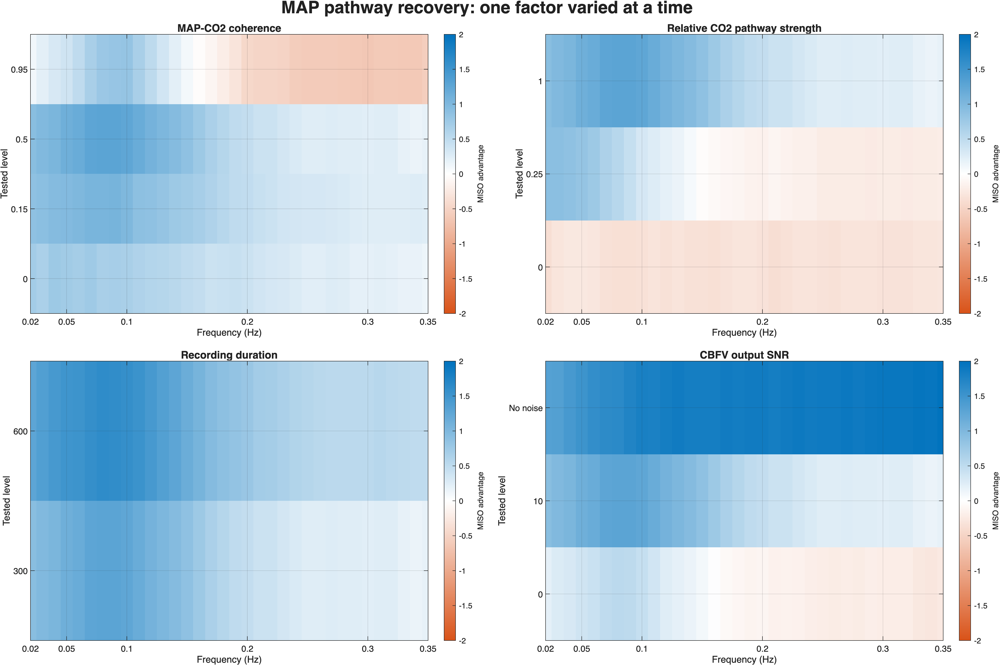
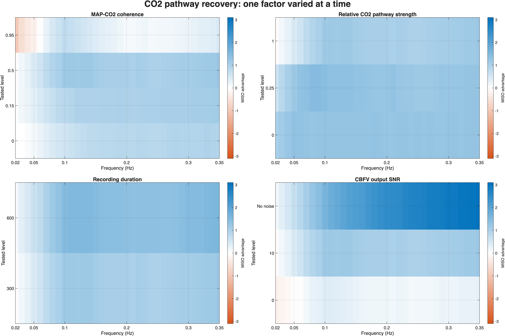
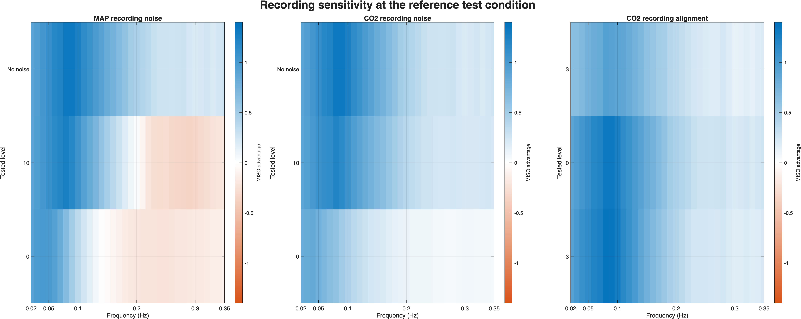
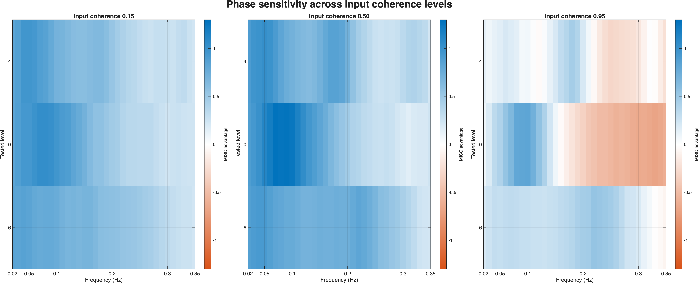
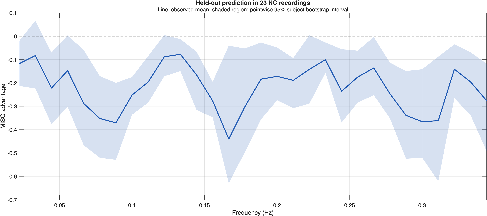

# Figure guide

`buildManuscript` creates these figures from the frozen numerical outputs. It
does not rerun the simulation. The order below follows the manuscript.

## Study workflow

The upper branch shows the known-truth simulation from assigned conditions to
pathway-recovery error. The lower branch shows the separate held-out NC
prediction analysis.

## NC input spectrum used by the simulation

The points show subject-median MAP and CO2 power. The mean curve and fitted
shape disclose how the input spectrum used by the simulation was chosen.

## Simulation repetitions

This explains the condition, replicate, paired-estimator, and bootstrap levels
without relying on the earlier ambiguous term “signal family.”

## Primary MAP-pathway results

Each panel varies one named quantity. Frequency is horizontal, the tested
level is vertical, and color is MISO advantage. The fixed settings are stated
in the manuscript caption.

## Primary CO2-pathway results

These panels use the same one-factor-at-a-time slices as the MAP figure but
compare MISO with CO2-only SISO.

## Recording sensitivity

MAP input noise, CO2 input noise, and CO2 alignment are varied separately at
the declared reference test condition.

## Timing sensitivity

MAP–CO2 lag is varied at three coherence levels. This prevents timing effects
from being interpreted without considering input dependence.

## Held-out NC validation

The line is the measured NC advantage and the shaded region is its pointwise
95% subject-bootstrap interval. The former synthetic comparison panel is not
part of the manuscript figure.

The older analytic-check and white-output-noise PNG files are retained only as
saved diagnostic assets. They are not manuscript figures or additional study
endpoints.
